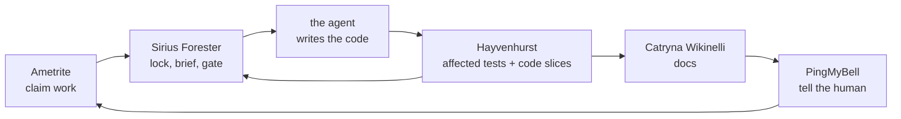

# Sothis — the local-first suite for running a fleet of Claude Code agents

The **Sothis suite** is six local-first developer tools for running a fleet of
AI coding agents against one repository without them tripping over each other.
Sirius Forester is the foreman: it claims work from a local issue tracker, locks
the code each task touches, briefs the agent, and refuses to mark anything done
until the affected tests pass. Hayvenhurst keeps a live code graph so "affected
tests" is a real answer rather than a guess. Ametrite holds the issues and the
knowledge base. Catryna Wikinelli keeps documentation that the code cannot
silently outgrow. PingMyBell rings the human when a decision is needed. Guignet
measures agents against your own git history. Each stands alone; Sothis owns
their distribution and compatibility contract without absorbing their runtime
responsibilities. Everything runs locally — SQLite ledgers, git-versioned docs,
no cloud accounts, and no suite telemetry.

Built for **Claude Code** and for **AI coding agents** generally. The core runs
on **Windows, macOS, and Linux**. Optional-tool support is declared honestly in
[`suite.manifest.json`](suite.manifest.json): Guignet uses WSL2 on Windows,
PingMyBell builds from source on Windows (source-only: no installer, no CI
runtime gate yet) and is still macOS-first, and the complete native Windows
Sirius loop remains preview until its shell-free execution lane passes. The
cross-tool rules the suite relies on (version handshake, doctor envelope,
Windows process spawning, peer resolution) are in
[`docs/CONTRACTS.md`](docs/CONTRACTS.md).

<!--
  getsothis.com is registered but does NOT resolve yet (checked 2026-08-24).
  Do NOT link it here until DNS is live and it serves 200 — a canonical or
  prominent link to a dead host is exactly the bug that is currently keeping
  catrynawiki.com out of search indexes (see SF-6). Once it answers, add it
  as the site link here and set it as this repo's homepage field.
-->

## The suite

| Tool | Role | CLI | Repo | Site |
| --- | --- | --- | --- | --- |
| Sirius Forester | foreman / the loop | `sirius` | [Davidb3l/Sirius-Forester](https://github.com/Davidb3l/Sirius-Forester) | [siriusforester.com](https://siriusforester.com) |
| Hayvenhurst | live code graph | `hayven` | [Davidb3l/Hayvenhurst-dev](https://github.com/Davidb3l/Hayvenhurst-dev) | [hayvenhurst.dev](https://hayvenhurst.dev) |
| Ametrite | issues + knowledge base | `amt` | [Davidb3l/Ametrite](https://github.com/Davidb3l/Ametrite) | [ametrite.com](https://ametrite.com) |
| Catryna Wikinelli | living documentation | `catryna` (bun plugin) | [Davidb3l/Catryna-Wikinelli](https://github.com/Davidb3l/Catryna-Wikinelli) | [catrynawiki.com](https://catrynawiki.com) |
| PingMyBell | notifications / the bell | — (desktop app, built from source) | [Davidb3l/pingmybell](https://github.com/Davidb3l/pingmybell) | — |
| Guignet | local agent evaluation / referee | `guignet` (from source) | [Davidb3l/Guignet](https://github.com/Davidb3l/Guignet) | [guignet.com](https://guignet.com) |

## Install

Sothis installs the suite's tools from their own signed GitHub releases. Pick
one way to get the `sothis` binary; it then installs everything else.

**Windows** (PowerShell 5.1 or 7):

```powershell
irm https://raw.githubusercontent.com/Davidb3l/Sothis/main/scripts/install.ps1 | iex
```

**macOS, Linux, or Git Bash on Windows:**

```sh
curl -fsSL https://raw.githubusercontent.com/Davidb3l/Sothis/main/scripts/install.sh | sh
```

**From a checkout** (needs a Rust toolchain; installs only the `sothis` binary,
then run `sothis install` yourself):

```sh
cargo install --path .
sothis install --profile core
```

The bootstrap scripts download the latest published Sothis release, verify its
sha256 and its Sigstore signature, place `sothis` in the Sothis bin directory
(see [Where things go](#where-things-go)), and then run
`sothis install --profile core`. Releases are built and signed by
[`release.yml`](.github/workflows/release.yml) when a `v*` tag is pushed. Pass
options to either script:

```powershell
& ([scriptblock]::Create((irm https://raw.githubusercontent.com/Davidb3l/Sothis/main/scripts/install.ps1))) -Profile docs -NoModifyPath
```

```sh
curl -fsSL https://raw.githubusercontent.com/Davidb3l/Sothis/main/scripts/install.sh | sh -s -- --profile docs --no-modify-path
```

| `install.ps1` | `install.sh` | |
| --- | --- | --- |
| `-Version <v>` | `--version <v>` | Release to install (default: latest) |
| `-Profile <p>` | `--profile <p>` | Profile for `sothis install` (default: `core`) |
| `-NoInstall` | `--no-install` | Only place `sothis`; do not install the tools |
| `-AllowMissingCosign` | `--allow-missing-cosign` | Accept checksum-only verification if cosign is absent (also passed to `sothis install`) |
| `-NoModifyPath` | `--no-modify-path` | Passed to `sothis install` |
| `-NoPlugins` | `--no-plugins` | Passed to `sothis install` |
| `-AllowVirtualizedRoot` | `--allow-virtualized-root` | Passed to `sothis install`; see [Running from the Claude desktop app on Windows](#running-from-the-claude-desktop-app-on-windows) |

The scripts fail closed: a sha256 that does not match, a missing checksum, a
missing cosign (without the opt-out) or a signature cosign rejects stops the
install before anything is unpacked. `install.ps1` never calls `exit` when piped
to `iex`, so it cannot close your terminal.

### Profiles

| Profile | Installs | Notes |
| --- | --- | --- |
| `core` (default) | Ametrite (`amt`), Hayvenhurst (`hayven`), Sirius Forester (`sirius`) | The supervised loop. Binaries are downloaded and verified. |
| `docs` | `core` + Catryna Wikinelli | Catryna is a Claude Code plugin that runs on [Bun](https://bun.sh); Sothis checks Bun (>= 1.2.0) and installs the plugin, but never installs Bun. |
| `bell` | PingMyBell | A desktop app with no CLI on `PATH`. Build it from source on macOS or Windows; unsupported on Linux. Sothis reports it, it does not install it. |
| `eval` | Guignet | Built from source. Runs through WSL2 on Windows. |
| `full` | Everything above | Tools the current platform cannot run natively are skipped or bridged, and reported as such, never hidden. |

`sothis install --profile <p> --plan` shows exactly what a profile resolves to
on your platform, including any `native-preview`, `wsl2`, `source-only` or
`unsupported` entries, and changes nothing. The profile can also be set per
project with `sothis init` (`.suite/config.json`).

### What `sothis install` does

For each tool in the profile, in order:

1. **Staged download.** The release asset and its `.sha256` are fetched into a
   staging directory under the Sothis root, never into your bin directory.
2. **Verification, fail closed.** The sha256 must match and the sidecar must name
   that asset. Hayvenhurst and Sirius Forester also publish a Sigstore bundle,
   checked with [cosign](https://github.com/sigstore/cosign) against the tool's
   own release workflow identity; Ametrite publishes a checksum only. A missing
   cosign is an error (`winget install Sigstore.Cosign`, `brew install cosign`);
   `--allow-missing-cosign` accepts checksum-only verification with a loud
   warning and records that in the receipt. A cosign that runs and rejects the
   signature is always fatal. Nothing is unpacked before verification passes.
3. **Atomic placement.** Files are staged beside their destination and renamed
   in; an existing file is moved aside, not overwritten (a running `.exe` cannot
   be overwritten on Windows, but it can be renamed). The placed command must
   report exactly the installed version via `--version`.
4. **Receipts.** `state/receipts/<tool>.json` records the version, asset hash,
   signature status and the hash of every file Sothis placed. Only files a
   receipt owns are ever replaced or removed. Existing, unmanaged copies are
   backed up and restored on uninstall.
5. **Rollback.** If a tool fails at any step, its changes are undone and the
   previous state is left exactly as it was; tools that already succeeded are
   kept and the command exits `1`. The previous version of each tool is retained
   for `sothis rollback`.

Then it prepends the bin directory to your user `PATH` on Windows (see
[The PATH note](#the-path-note)) and installs the suite's Claude Code plugins
through the `claude` CLI (`sothis@sothis`, plus each tool's plugin). Pass
`--no-modify-path` and `--no-plugins` to skip either.

### Day to day

```sh
sothis update              # move managed tools to the manifest's recommended versions
sothis rollback <tool>     # return one tool to its previous retained version
sothis uninstall           # remove what Sothis installed, in reverse order (--plugins also removes plugins)
sothis doctor              # check the install (see below)
sothis env                 # where Sothis keeps things
sothis manifest validate   # validate the embedded suite contract
```

`update` never downgrades without `--allow-downgrade`, and leaves tools it did
not install alone (reporting them as `unmanaged`). `uninstall` never touches
tool data (`.ametrite`, `.hayven`, `.sirius`, `.suite`).

`sothis doctor [--profile <p>]` exits `0` only when nothing it checks has
failed. It reports:

- each tool's `--version` against the manifest minimum, and each delegated
  tool's own `doctor --json` verdict (see [`docs/CONTRACTS.md`](docs/CONTRACTS.md));
- **every copy of a command on `PATH`**: more than one is a warning, and a stale
  first copy shadowing a good one is a failure (`remove the stale copy`);
- the installed Claude plugin version against the manifest minimum (Catryna
  needs `1.3.1`), and the Bun runtime version;
- whether the files Sothis placed still match their receipts, and whether the
  Sothis bin directory is on `PATH`;
- Sirius's integration contracts, run from the nearest enclosing directory with a
  `.sirius/` folder, and skipped outside a Sothis workspace.

Output marks each line `[OK]`, `[WARN]`, `[FAIL]` or `[SKIP]`; `--json` adds a
`status` (`pass`, `warn`, `fail`, `skip`) and an `ok` flag per check.

### Where things go

`sothis env` prints the exact locations.

| | State root (receipts, retained versions, staging) | Bin directory (what lands on `PATH`) |
| --- | --- | --- |
| Windows | `%USERPROFILE%\.sothis` | `%USERPROFILE%\.sothis\bin` |
| macOS / Linux | `$XDG_DATA_HOME/sothis`, else `~/.local/share/sothis` | `~/.local/bin` |
| `SOTHIS_HOME=<abs dir>` | `<dir>` | `<dir>/bin` |

The Windows root is a dot-directory in your profile, like `.cargo` and `.bun`,
and deliberately **not** under `%LOCALAPPDATA%` (v0.1.0's default); see
[Running from the Claude desktop app on Windows](#running-from-the-claude-desktop-app-on-windows).

`SOTHIS_HOME` replaces the whole layout on every OS; use it to try an install
in a throwaway directory (`--no-modify-path --no-plugins` keep it hermetic).
`SOTHIS_RELEASE_MIRROR` (or `--mirror <dir>`) reads assets from
`<dir>/<owner>/<repo>/v<version>/` instead of GitHub, and `SOTHIS_COSIGN` names
the cosign binary.

### The PATH note

On Windows `sothis install` prepends the bin directory to the **user** `PATH`
(`HKCU\Environment`), preserving the value's type, and removes it on uninstall
when no managed tools remain. **A changed `PATH` only reaches new processes**:
close and reopen your terminals, your editor and Claude Code. On macOS and Linux
Sothis never edits shell profiles; it prints the line to add, for example
`export PATH="$HOME/.local/bin:$PATH"`. If another directory earlier on `PATH`
provides the same command, the install says so (and `sothis doctor` keeps
saying so until it is fixed).

If a v0.1.0 install is still at `%LOCALAPPDATA%\Sothis`, `sothis install` removes
exactly that one entry (`%LOCALAPPDATA%\Sothis\bin`, in any spelling) from your
user `PATH` while adding the new bin directory, and reports it as a migration
line. It leaves everything else on `PATH` alone, and it never adopts or deletes
the old folder; it prints how to remove it instead (`sothis doctor` warns as
`legacy_root`):

```powershell
$env:SOTHIS_HOME = "$env:LOCALAPPDATA\Sothis"
sothis uninstall --profile <the profile you installed> --no-modify-path
# then delete the %LOCALAPPDATA%\Sothis folder
```

### Running from the Claude desktop app on Windows

The Claude desktop app is an MSIX-packaged app. Windows runs the processes it
starts (including Claude Code's shells, and so `sothis` and `install.ps1`)
inside the package container, where **file-system virtualization silently
redirects new writes under `%LOCALAPPDATA%` and `%APPDATA%`** into
`%LOCALAPPDATA%\Packages\<package>\LocalCache\...`. Registry writes are not
redirected. So v0.1.0, which installed under `%LOCALAPPDATA%\Sothis`, put the
tools where only the container could see them while the `PATH` edit pointed
every other process at a directory that does not exist.

Since v0.1.1 the default root is `%USERPROFILE%\.sothis`, which is not
virtualized (the same reason the per-tool installers that write to
`%USERPROFILE%\.local\bin` or `%USERPROFILE%\.cargo\bin` work from Claude
sessions). In addition:

- `sothis doctor` notes when it runs inside a package and **fails**
  `root_not_virtualized` if the effective root (including a `SOTHIS_HOME`
  override) is under `%LOCALAPPDATA%` or `%APPDATA%`.
- `sothis install` and `sothis update` refuse to run in that situation, writing
  nothing, unless you pass `--allow-virtualized-root`.
- `install.ps1` does the same before placing `sothis.exe`
  (`-AllowVirtualizedRoot` to override).

Detection uses `GetCurrentPackageFullName`; a normal terminal is not packaged,
so none of this applies there.

### Windows Smart App Control

On Windows 11 with **Smart App Control** (SAC) turned on, Windows may refuse to
start a binary that has no trusted Authenticode signature, even though its
sha256 and Sigstore signature verified. Ametrite, Hayvenhurst and Sirius Forester
do not carry an Authenticode signature yet, so `sothis doctor` (or the tool
itself) can fail with `os error 4551`; Sothis names that error and points here.
Your options:

- **Build from source.** Build the tool from its repository (see the table
  above) instead of using the downloaded binary.
- **Wait for signed builds**, which are not available yet.
- Turning SAC off lets the downloaded binaries run, but **SAC cannot be turned
  back on without resetting or reinstalling Windows**, so it is not something to
  do casually, and Sothis does not suggest it as a fix.

### Claude Code plugins

`sothis install` handles these for you. To manage them by hand:

```bash
claude plugin marketplace add Davidb3l/Sothis
claude plugin install sothis@sothis
claude plugin install sirius@sothis
claude plugin install hayvenhurst@sothis
claude plugin install catryna@sothis
```

These commands are non-interactive, so you can also just ask Claude Code to run
them. In the desktop app the same thing is available as **+** → **Plugins** →
**Add plugin**, and in a terminal session as the `/plugin` dialog. The old
`@sirius-forester` identities remain accepted for a two-release migration
window; every new suite-controlled surface uses `@sothis`.

## How they fit together

The Sothis suite is a loop, not a framework. Each tool owns one store and talks to
the others only through their CLIs and an **MCP server** where an agent needs
structured access — so any one of them can be swapped, skipped, or run alone.

Ametrite holds the work. Sirius claims one issue at a time, asks Hayvenhurst
which symbols that issue touches, takes a lock on them, and hands the agent a
brief. The agent works. On the way out Sirius asks Hayvenhurst for the tests
affected by the actual diff and gates completion on them passing. Catryna
updates the docs that describe the changed code and flags the ones that drifted.
PingMyBell tells the human when the loop needs a decision or a run is done.



## Why local-first

- **SQLite ledgers.** Claims, locks, receipts, issues, and the code graph live
  in local databases inside the repo you are working on.
- **Git-versioned docs.** Catryna's documentation is MDX in `.docs/`, reviewed
  in the same pull request as the code it describes.
- **No cloud.** Nothing is uploaded, and the tools make no LLM calls of their
  own — the agents bring their own model.
- **No accounts.** No sign-up, no API key, no seat. Install the binaries and go.
- **Readable by hand.** Every store is inspectable with the CLI or with
  `sqlite3`, so you are never locked out of your own history.

## Troubleshooting

### `claude plugin install` fails with `Permission denied (publickey)`

**Symptom.** `claude plugin marketplace add Davidb3l/Sothis` succeeds,
then the very next command fails — first with `No ED25519 host key is known for
github.com`, and after you add the host keys, with `Permission denied
(publickey)`.

**Cause.** Older Sothis/Sirius marketplace revisions used repository shorthand
for `git-subdir` sources, which some Claude Code versions resolved over SSH. On
a machine with no GitHub SSH key — the normal state of a fresh Windows box —
the clone has nothing to authenticate with. The canonical Sothis marketplace
now uses explicit HTTPS URLs; update it before applying the fallback below.

**Fix.** Rewrite the SSH remote to HTTPS for that one command, through git's
environment-variable config so nothing on disk changes:

```bash
GIT_CONFIG_COUNT=1 \
GIT_CONFIG_KEY_0=url.https://github.com/.insteadOf \
GIT_CONFIG_VALUE_0=git@github.com: \
claude plugin install hayvenhurst@sothis
```

```powershell
$env:GIT_CONFIG_COUNT=1; $env:GIT_CONFIG_KEY_0='url.https://github.com/.insteadOf'; $env:GIT_CONFIG_VALUE_0='git@github.com:'
claude plugin install hayvenhurst@sothis
```

Repeat for whichever legacy plugin source failed. In PowerShell the variables
live for the rest of the session, so drop them again with `Remove-Item Env:GIT_CONFIG_COUNT,
Env:GIT_CONFIG_KEY_0, Env:GIT_CONFIG_VALUE_0` when you are done.

### Installed, but `sirius: command not found`

**Symptom.** `sothis install` reports success and the binaries are on disk, but
`sirius`, `hayven`, or `amt` is not found in your shell.

**Cause.** The Sothis bin directory is not on that shell's `PATH`. Either you
passed `--no-modify-path`, or the shell was started before the install and
**`PATH` changes only reach new processes**. On macOS and Linux Sothis never
edits your shell profile; it prints the line to add instead.

**Fix.** Run `sothis env` to see the bin directory, and `sothis doctor` to see
whether it is on `PATH`. On Windows, rerun `sothis install` without
`--no-modify-path` (it prepends the directory to your user `PATH`; it is
idempotent), then close and reopen your shells, your editor, and Claude Code. On
macOS and Linux add the printed line to your shell profile:

```bash
export PATH="$HOME/.local/bin:$PATH"   # in ~/.zshrc or ~/.bashrc
```

If `sothis doctor` warns that a command has several copies on `PATH`, or that an
earlier entry shadows a newer one, delete the stale copy it names (typically an
old `~/.local/bin` or `~/.cargo/bin` binary from before Sothis managed it).

### The installer refuses to run or stops before installing

**Symptom.** `install.ps1`, `install.sh` or `sothis install` ends with an error
and installs nothing for that tool. Nothing is half-installed: a failed tool is
rolled back.

**Cause and fix**, by message:

- **`cosign was not found`**: the Sigstore signature cannot be verified, so the
  install fails closed. Install cosign (`winget install Sigstore.Cosign`,
  `brew install cosign`, or a release from
  [sigstore/cosign](https://github.com/sigstore/cosign/releases)), or point
  `SOTHIS_COSIGN` at it. Only if you accept checksum-only verification, pass
  `--allow-missing-cosign` (`-AllowMissingCosign` for the PowerShell script).
- **`sha256 mismatch`** or **`cosign rejected the signature`**: the download is
  corrupt or is not what the release published. This is never bypassed by a
  flag. Retry once on a clean network; if it persists, do not install.
- **`unsupported platform` / `musl` / `ARM64`**: Sothis publishes `windows-x64`,
  `macos-x64`, `macos-arm64`, `linux-x64` (glibc) and `linux-arm64` builds only.
  `sothis install --profile core --plan` shows what your platform resolves to.
- **`another sothis install/update/uninstall is already running`**: a second `sothis install`,
  `update`, `uninstall` or `rollback` holds the lock; wait for it to finish.
- **`os error 4551`** on Windows: see
  [Windows Smart App Control](#windows-smart-app-control).

Update the suite plugin with `claude plugin update sothis@sothis` when a new
release lands. A tool you installed some other way is left alone: `sothis
update` reports it as `unmanaged`, and `sothis install` takes it over only after
backing the existing file up.

## Docs

- Suite contracts (version handshake, doctor envelope, Windows spawning, peer
  resolution, schema numbers, plugin identities) —
  [`docs/CONTRACTS.md`](docs/CONTRACTS.md)
- Sirius Forester — [siriusforester.com](https://siriusforester.com) ·
  [getting started](https://siriusforester.com/docs/getting-started/)
- Hayvenhurst — [hayvenhurst.dev](https://hayvenhurst.dev)
- Ametrite — [ametrite.com](https://ametrite.com)
- Catryna Wikinelli — [catrynawiki.com](https://catrynawiki.com)
- PingMyBell — [github.com/Davidb3l/pingmybell](https://github.com/Davidb3l/pingmybell)

## License

MIT. See [LICENSE](LICENSE).
